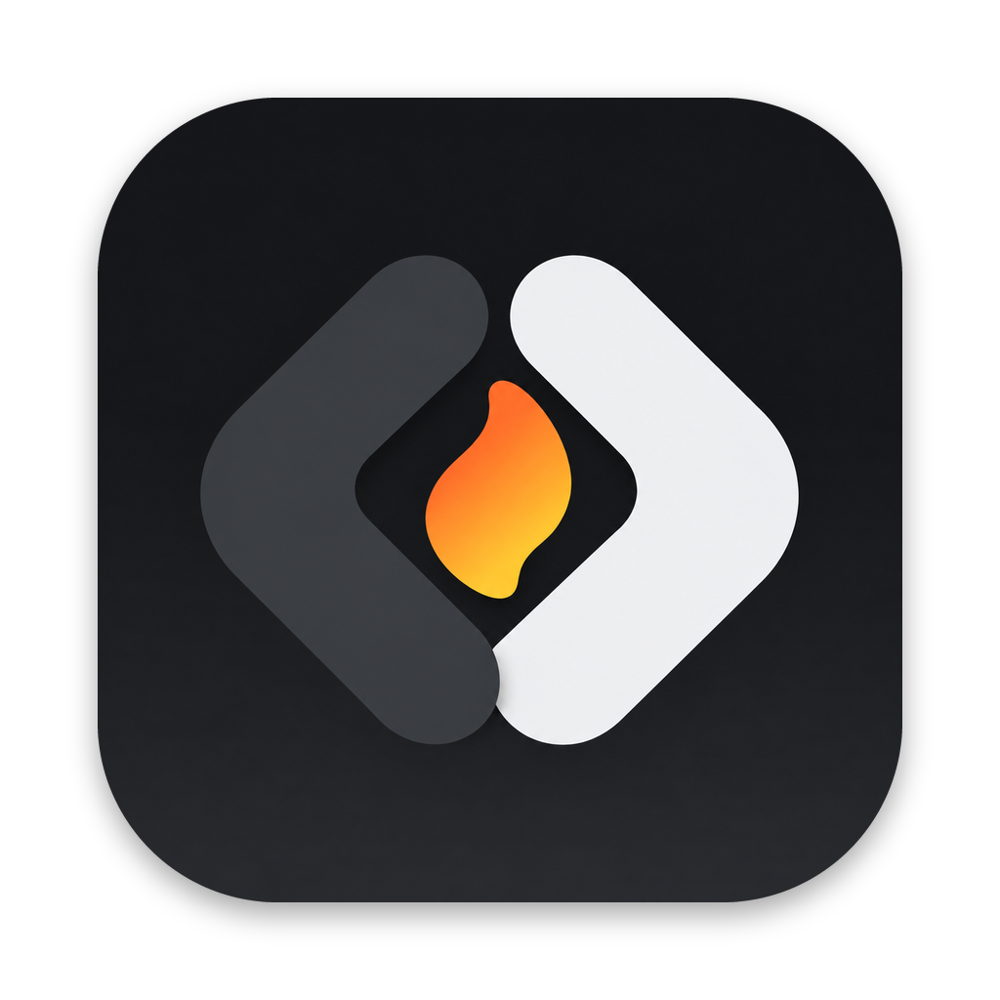

<p align="center">
  
</p>

<h1 align="center">Code-Maxxer</h1>

<p align="center">
  A team of AI agents that sees your project through: spec, design, code, QA and report.<br />
  <a href="https://federicocasarella.com/code-maxxer"><b>Website</b></a>
</p>

---

Code-Maxxer is a macOS desktop app for people who build with Claude Code and Cursor. You write a request in
a chat; agents work on it in parallel on your Mac, inside the project folder, each on its own git branch.
The decisions stay yours: they ask when something is unclear, and nothing ships without your OK.

## What it does

- **Chat with agents, per branch.** Every project gets branches you can run side by side. Messages sent
  while an agent is busy wait in a queue and go together in its next turn. Steer one to interrupt and send it now.
- **Pipelines.** A request can run through a pipeline (spec → design → build → QA → review…), node by node,
  and loop back when QA fails. Build pipelines visually, in YAML, or by describing the change.
- **Brain and auto learning.** Issues, decisions and lessons go to the project's brain, which agents
  search through tools instead of carrying it in context. After a run, lessons are proposed for you
  to keep; the ones you keep guide the next runs. A lesson learned during a run shows up right in the chat.
- **Live preview.** A built-in browser starts your dev server and shows the app at the size you pick
  (Responsive, iPhone, iPad, Mac, Desktop, Ultrawide). Agents check their own work in it.
- **Plans and questions.** Bigger tasks come with a plan you can follow step by step. When the agent needs
  your input it asks, and your answers come back as a numbered card.
- **Automations and scheduled runs.** Let a prompt run on its own, on a schedule.
- **Reports.** How much time the agents saved you, where it came from and which agents did the most.
- **Dictation.** Talk instead of typing, with Apple's on-device speech recognizer (macOS 26+).
- **Pro:** Design System, Recon and Cyber Security pages.

Works with Claude Code (required), with Codex and OpenCode as extra providers.

## Run from source

```bash
npm install
npm run db:up      # Postgres in Docker on 127.0.0.1:5477
npm run dev
```

You need the `claude` CLI installed and signed in. `npm run typecheck` checks both the main and renderer code.

## Layout

- `src/main`: Electron main process (database, orchestrator that runs the agents, git, preview browser, dictation)
- `src/main/mcp/cm2-mcp.ts`: MCP server the agents use (pipeline steps, brain, plans, preview, questions)
- `src/renderer`: the UI, in React 19 and Tailwind 4
- `src/renderer/src/components/affect`: [affectUI](https://www.affectui.com) components (MIT)
- `resources/dictate`: the Swift dictation helper

Stack: Electron, electron-vite, React 19, Tailwind 4, affectUI, Postgres.
