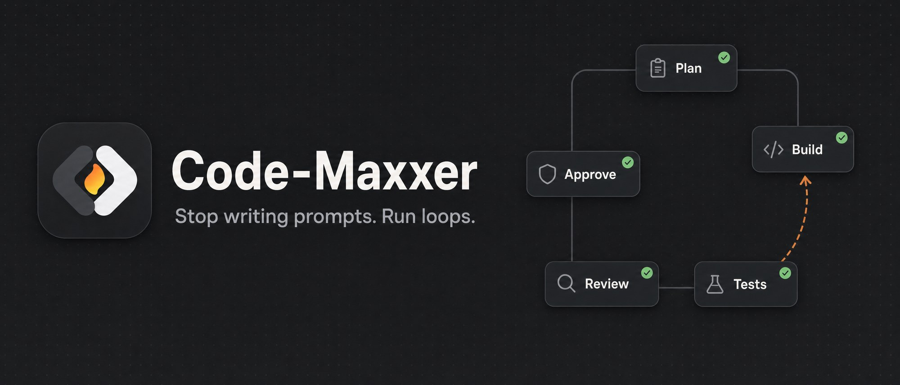
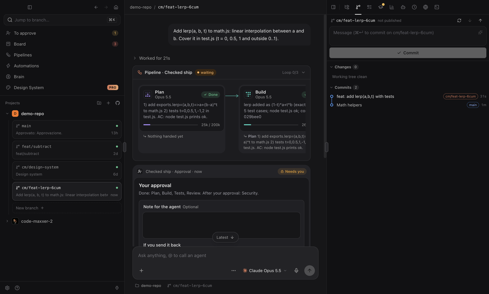
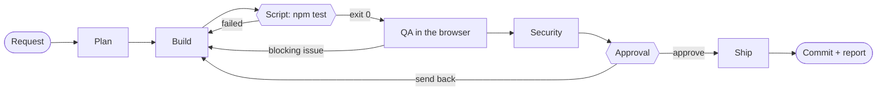
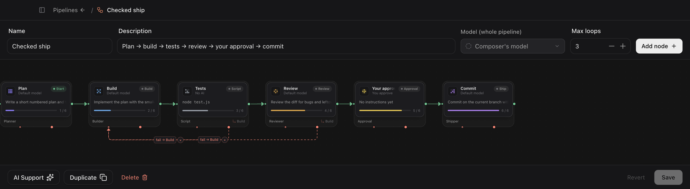
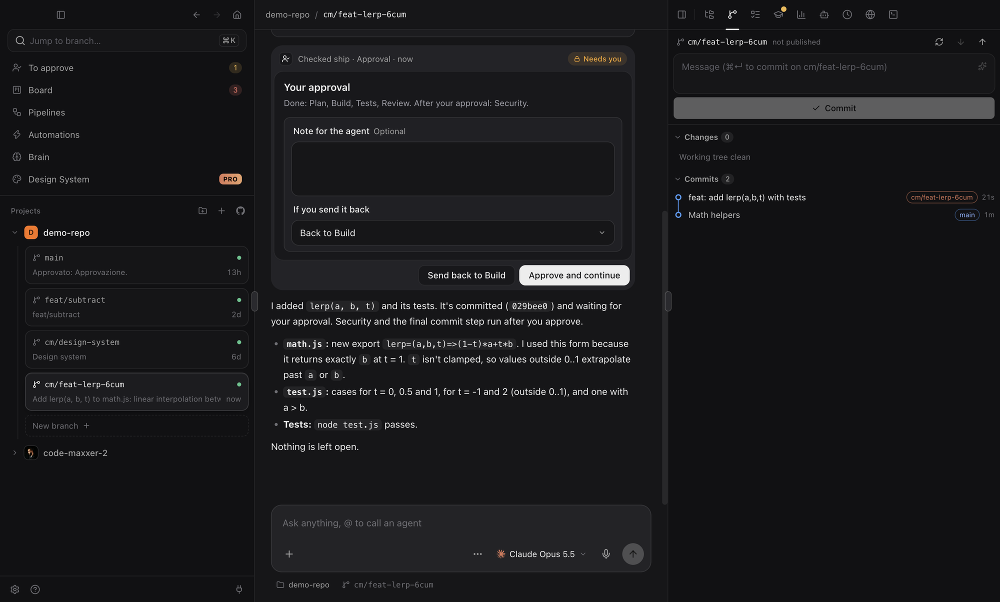
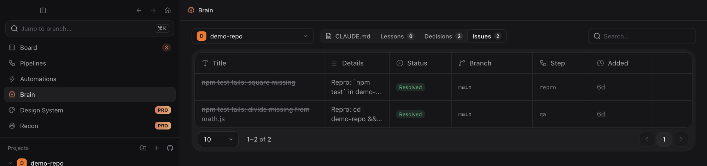
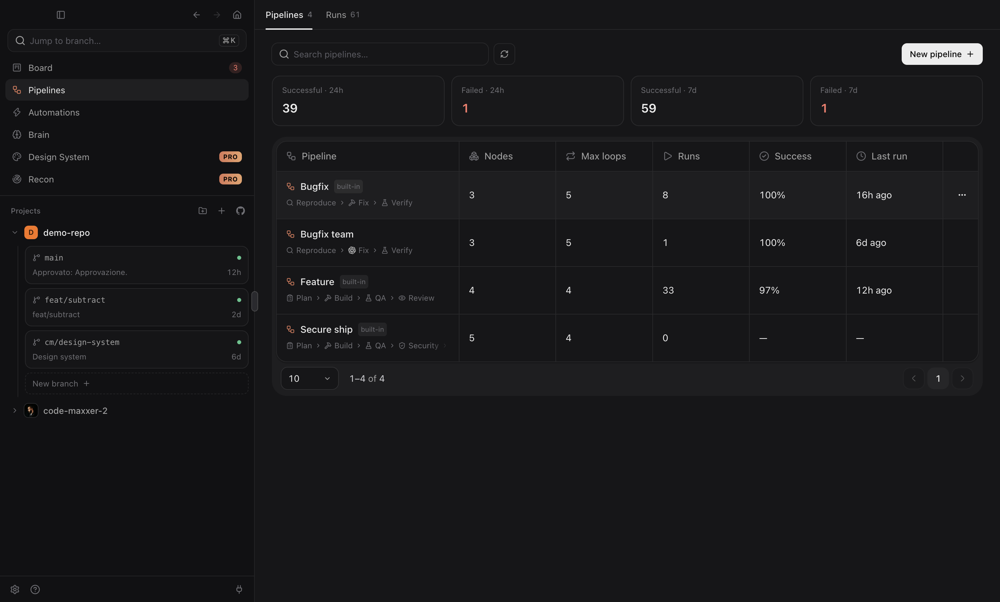

<p align="center">
  
</p>

<h1 align="center">Code-Maxxer: AI coding agents that run in loops</h1>

<p align="center">
  <a href="https://github.com/FedericoCasarella/code-maxxer-2/releases/latest"></a>
  
  
  <a href="https://github.com/FedericoCasarella/code-maxxer-2/stargazers"></a>
</p>

<p align="center">
  <a href="#three-ways-to-work">Three ways to work</a> ·
  <a href="#quick-start">Quick start</a> ·
  <a href="#how-pipelines-work">Pipelines</a> ·
  <a href="#features">Features</a> ·
  <a href="#faq">FAQ</a> ·
  <a href="#project-layout">Layout</a> ·
  <a href="https://federicocasarella.com/code-maxxer">Website</a>
</p>

> "My job is to write loops."
> Boris Cherny, head of Claude Code at Anthropic ([TechCrunch](https://techcrunch.com/2026/06/22/the-ai-world-is-getting-loopy/))

**Code-Maxxer** is a Mac app that turns Claude Code into a team of AI coding agents. You write what you
want once. The agents plan it, build it, test it in a real browser, review it, check it for security holes
and loop until the result holds up. You step in only where a decision is yours: an approval, a question,
a lesson worth keeping.

It runs on your Mac, inside your project folder, with Claude Code as the engine and Codex and OpenCode as
extra providers. Every git branch is its own workspace with its own agent and worktree, so several loops
run side by side. No server to host, no Docker for end users: download the app and open a project.

## Three ways to work

| | **Direct** | **Sentient** | **Pipeline** |
| --- | --- | --- | --- |
| Best for | Questions, quick edits, git chores | Everyday work: let the app decide | Repeatable delivery with fixed steps and sign-off |
| How it runs | One agent acts on the files right away | The orchestrator answers itself when nothing changes, and sends every change to a loop: a library pipeline for real work, a flash pipeline built for the task for small changes | The engine runs Agent, Script and Approval nodes in order, with rules for going back when a check fails |
| You stay in control by | Queuing messages, or **Steer** to interrupt now | Seeing why it picked a loop before it starts | Approving at gates, sending work back to a chosen step, adding loops when the budget runs out |
| Delivers | A change in your worktree | A checked, reviewed change | Commits, per-node reports, issues and lessons in the brain |

All three share the same **brain** (issues, decisions, lessons), so a fix found in chat is known by the next
pipeline run and the other way round.

<p align="center">
  
</p>

<p align="center"><sub>The chat. Each branch is a conversation with its own agent and worktree; a pipeline run shows every node, what it handed to the next one and its commits.</sub></p>

## Why Code-Maxxer

Ask a coding agent to "fix this bug" and the result depends on that run. It might skip the plan, forget the
tests, review its own code, or report "done" when nothing changed. That's fine for a demo, not for shipping.

- **Loops, not prompts.** A pipeline names the steps and the way back: when QA fails, Build runs again with
  only the failures attached. The loop ends when the checks pass, not when the agent says so.
- **Checked verdicts.** A step can't pass with open blocking issues, a Build can't pass if no file changed,
  and a Script node is judged by its exit code, not by the model.
- **Human on the loop.** Approval nodes stop the run where a person must decide. Every waiting run lands in
  one **To approve** inbox in the sidebar.
- **Memory that compounds.** Issues, decisions and lessons go to the project's brain. Agents search it with
  tools instead of carrying it in context, so long projects stay fast and cheap.
- **Your machine, your tools.** Runs on your Mac, in your repo, with your Claude Code login. Codex and
  OpenCode can play any node.

## Quick start

1. Download `Code-Maxxer-<version>-arm64.dmg` from [Releases](https://github.com/FedericoCasarella/code-maxxer-2/releases/latest) (Apple Silicon, macOS 13 or later).
2. Open it and drag **Code-Maxxer** into Applications.
3. The app isn't notarized yet: the first time, macOS says it can't verify the developer. Open
   **System Settings → Privacy & Security** and click **Open Anyway** (once).
4. Install [Claude Code](https://claude.com/code) and sign in:

```bash
npm install -g @anthropic-ai/claude-code
```

```bash
claude
```

Everything else is inside the app, database included. Add a local folder or clone a GitHub repository, pick
a branch and write your first request.

### What you need

| I want to… | You need |
| --- | --- |
| Chat with agents and run pipelines | Claude Code installed and signed in |
| Use Codex or OpenCode on some nodes | That CLI installed and signed in |
| Clone repositories from GitHub | A GitHub account connected in the app |
| Dictate instead of typing | macOS 26 or later (on-device, nothing leaves the Mac) |

<details>
<summary><b>Run from source</b></summary>

<br>

```bash
npm install
```

```bash
npm run db:up      # Postgres in Docker on 127.0.0.1:5477
```

```bash
npm run dev
```

`npm run typecheck` checks the main and renderer code. `npm run dist` builds the `.dmg` into `release/`.
You need the `claude` CLI installed and signed in.

</details>

## How pipelines work

A **pipeline** is the loop a change follows. Agents, scripts and you take part in the same run:



<p align="center">
  
</p>

<p align="center"><sub>The pipeline editor. Draw it on the canvas, write it in YAML, or describe the change and let AI Support edit the graph.</sub></p>

| Node | What it does |
| --- | --- |
| **Agent** | A role (Planner, Investigator, Builder, QA, Reviewer, Security, Shipper, or your own agent) with its instructions, model and tools. |
| **Script** | A deterministic shell command: tests, typecheck, build, lint. Code-Maxxer runs it and reads the exit code. No AI, no tokens. |
| **Approval** | Pauses the run until you approve, send the work back to a step with a note, or stop the pipeline. |

Each node can run on a different model and provider. When a node fails, the work goes back to the node you
chose, with only the open blocking issues attached; after the loop budget runs out, the run waits for you
instead of burning tokens. Issues are **blocking** (bugs, failed checks, broken criteria, security holes) or
**minor** (style, naming, nice-to-haves): only blocking ones fail a node.

Built-in pipelines: **Feature**, **Bugfix** and **Secure ship**. In Sentient mode, small changes get a
**flash pipeline** made for the task, often just Build and a Script check.

<p align="center">
  
</p>

<p align="center"><sub>A run waiting at an approval node: approve and continue, or send the work back with a note.</sub></p>

## Features

| Area | What you get |
| --- | --- |
| **Chat, one branch each** | Every branch is a chat with its own agent and git worktree. Several run at once; steps fold into one live line you can open. |
| **Queue and Steer** | Write while the agent works: messages queue and go together when the turn ends. **Steer** sends now and interrupts. |
| **Pipelines** | Visual canvas and YAML, Agent / Script / Approval nodes, loop rules, per-node model, handoff reports, a **To approve** inbox. |
| **Sentient mode** | The orchestrator routes each request: answer, flash pipeline or library pipeline, and tells you why. |
| **Plans and questions** | Bigger tasks start with a plan (steps, files, live status, commits). When something is unclear, the agent asks. |
| **Brain** | Issues, decisions and lessons per project, searched with tools. QA files each failure and resolves it when fixed. |
| **Auto learning** | After each run, a small model proposes lessons from what went wrong. You keep the ones you agree with. |
| **Live preview** | A built-in browser starts your dev server and shows the app at real device sizes. Agents use it to click through and check the layout. |
| **Board** | Every open issue across branches, by status. |
| **Automations** | Prompts that run on a schedule, on the branch and with the settings you choose. |
| **Reports** | Time saved, what it would have cost by hand, where the time went, which agents did the most. |
| **Agents and skills** | Your own agents with instructions, model and tools, called with `@name`. The orchestrator proposes new ones when it spots a repeated need. |
| **Dictation** | Apple's on-device speech recognizer. Nothing leaves the Mac. |
| **Pro** | Design System, Recon (environments, uptime, incidents), Cyber Security, Code Review and Documentation. |

<p align="center">
  
</p>

<p align="center"><sub>The brain. What one run learns, the next one starts from.</sub></p>

<p align="center">
  
</p>

<p align="center"><sub>The pipelines library, with runs and success rate for each loop.</sub></p>

## FAQ

**Is Code-Maxxer a replacement for Claude Code?**
No, it runs on top of it. Every agent step and every chat turn is a Claude Code session (or Codex, or
OpenCode). Code-Maxxer adds what surrounds it: who does what, in which order, with which checks, what gets
remembered and who signs off.

**How is it different from Cursor or other AI IDEs?**
An AI IDE helps you write code one prompt at a time. Code-Maxxer runs the loop for you: plan, build, test,
review, fix, and only then asks you.

**How is it different from LoopForge, Dify or n8n?**
Dify and n8n are general workflow builders. LoopForge is a self-hosted team server with Docker sandboxes.
Code-Maxxer is a desktop app for one developer or a small team: no server, it works in your own repo and
worktrees, with a live browser preview, a persistent brain and learning between runs.

**Do I need an API key?**
No. Code-Maxxer uses your Claude Code login. Codex and OpenCode use theirs.

**Does my code leave my Mac?**
Only what the model provider you chose receives, as with Claude Code itself. The database, brain, reports and
dictation stay on your Mac.

**Does it push to my repository?**
Not by itself. The Shipper commits on the current branch and never pushes. Pushes happen when you ask.

**Which platforms are supported?**
macOS on Apple Silicon (macOS 13 or later). Dictation needs macOS 26 or later.

## Project layout

- `src/main`: Electron main process: database, the orchestrator that runs agents and loops, git, preview browser, dictation
- `src/main/engine/pipelines.ts`: the pipeline engine: steps, loops, waits and approvals
- `src/main/mcp/cm2-mcp.ts`: the MCP server agents use for pipeline steps, script nodes, the brain, plans, the preview and questions
- `src/renderer`: the UI, in React 19 and Tailwind 4
- `src/renderer/src/components/affect`: [affectUI](https://www.affectui.com) components (MIT)
- `resources/dictate`: the Swift dictation helper

Built with Electron, electron-vite, React 19, Tailwind 4, affectUI, Postgres and the Model Context Protocol.

## Contributing

Issues and PRs are welcome: share a use case, report a bug, or propose a pipeline. If Code-Maxxer is useful
to you, a star helps others find it.

<a href="https://star-history.com/#FedericoCasarella/code-maxxer-2&Date">
  
</a>
