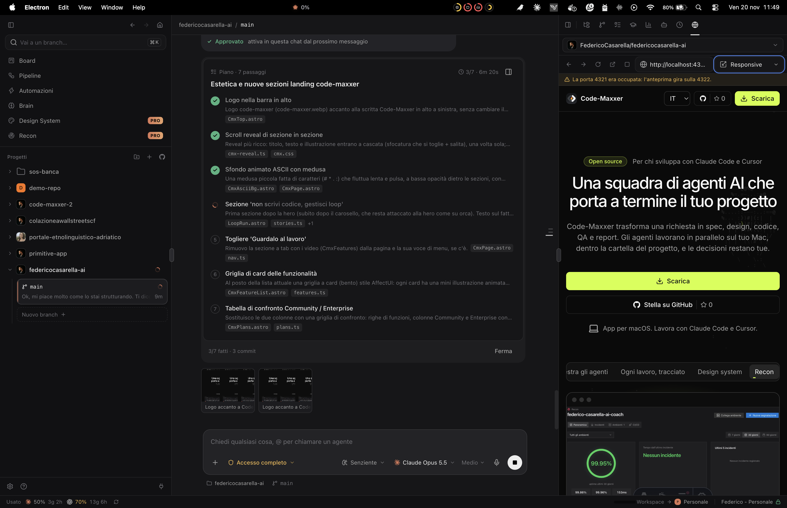

<p align="center">
  
</p>

<h1 align="center">Code-Maxxer</h1>

<p align="center">
  <b>Stop writing prompts. Run loops.</b><br />
  A team of AI agents that sees your project through: spec, design, code, QA and report.<br /><br />
  <a href="https://federicocasarella.com/code-maxxer"><b>Website and download →</b></a>
</p>

<p align="center">
  
</p>

---

> "My job is to write loops."
> Boris Cherny, head of Claude Code at Anthropic ([TechCrunch](https://techcrunch.com/2026/06/22/the-ai-world-is-getting-loopy/))

The people who build Claude Code no longer prompt it one message at a time. They set up loops that
prompt the agent, check its work and send it back until the job is done. Their time goes to deciding,
not typing.

**Code-Maxxer is that way of working, as a Mac app.** You write what you want once. A crew of agents
plans it, builds it, tests it in a real browser, records what went wrong, learns from it and loops
until the result holds up. You step in only where a decision is yours.

It runs on your Mac, inside your project folder, on top of Claude Code (with Codex and OpenCode as
extra providers). Every branch is its own workspace, so several loops can run side by side.

## The loop

```
 your request ─► plan ─► build ─► check in the browser ─► QA ──┐
                  ▲                                            │ failed: back to build,
                  └──────────── lessons from every run ◄───────┘ with what broke
```

Each turn of the loop leaves something behind: a commit, a screenshot, an issue in the brain, a lesson.
The next turn starts from there, not from zero.

## Features

### Chat with agents, one branch each
Every project holds branches, and each branch is a chat with its own agent and its own git worktree.
Run several at once and switch between them from the sidebar: a working project shimmers, its active
branch shows a spinner. While the agent works, its steps fold into one line that shows the latest step.
Open it to see every command, file and search.

### Queue and steering
Write while the agent is busy: messages wait in a queue under the composer. When the turn ends, the
queued messages go together in one turn, so the agent sees the whole picture. Each one still shows as
its own message. **Steer** sends one right away and interrupts the current turn.

### Pipelines: loops you design
A pipeline is a loop with named steps (spec → design → build → QA → review → ship) and rules for going
back: when QA fails, the build step runs again with the failures attached. Draw it on a canvas, write it
in YAML, or describe the change and let AI Support edit the graph. Each step can run on a different model,
handing its context to the next agent. Simple requests skip the pipeline, and small routine tasks run on
the cheapest model.

### Plans and questions
Bigger tasks start with a plan: numbered steps, the files each one touches, live status and commits as
they land. When something is unclear the agent asks instead of guessing. Your answers come back as a
numbered card in the chat.

### Brain
Issues, decisions and lessons are saved to the project's brain. Agents search it with tools instead of
carrying it in their context, so long projects stay fast and cheap. QA files every failure as an issue
and resolves it when it's fixed.

### Auto learning
When a run ends, a small model looks at what went wrong or cost time and proposes lessons: what the agent
should always do, never do, or know about this project. You keep the ones you agree with, and they guide
every next run. When an agent learns a lesson mid-run, it shows up in the chat as a "Lesson learned" card.

### Live preview
A built-in browser starts your dev server, finds a free port and shows the app next to the chat. Pick the
viewport (Responsive, iPhone, iPad, Mac, Desktop, Ultrawide): the page renders at its real size, scaled to
fit the panel. Agents use the same browser to click through the app, take screenshots and check the layout
at every size before saying it's done.

### Automations and scheduled runs
Let a prompt run on its own, on a schedule, on the branch and with the settings you choose.

### Reports
How much time the agents saved you, what it would have cost by hand, which steps the time went to and
which agents did the most. Pick today, 7, 30 or 90 days.

### Agents and skills
Create agents with their own instructions, model and tools, and call them with `@name` in the chat. The
orchestrator can propose new agents and skills when it spots a repeated need; they're added only if you
approve them.

### Dictation
Talk instead of typing, with Apple's on-device speech recognizer (macOS 26 or later). Nothing leaves the Mac.

### Pro
Design System, Recon (environments, uptime and incidents) and Cyber Security.

## Install

1. Download `Code-Maxxer-<version>-arm64.dmg` from [Releases](https://github.com/FedericoCasarella/code-maxxer-2/releases) (Apple Silicon, macOS 13 or later).
2. Open it and drag **Code-Maxxer** into Applications.
3. The app isn't notarized yet: the first time, macOS says it can't verify the developer. Open
   **System Settings → Privacy & Security** and click **Open Anyway** (once).
4. Install [Claude Code](https://claude.com/code) and sign in (`npm install -g @anthropic-ai/claude-code`, then `claude`).

Everything else is inside the app, database included: no Docker, nothing else to set up.
Dictation needs macOS 26 or later.

## Run from source

```bash
npm install
npm run db:up      # Postgres in Docker on 127.0.0.1:5477
npm run dev
```

`npm run dist` builds the `.dmg` into `release/`.

You need the `claude` CLI installed and signed in. `npm run typecheck` checks the main and renderer code.

## Layout

- `src/main`: Electron main process: database, the orchestrator that runs the agents and the loops, git, preview browser, dictation
- `src/main/mcp/cm2-mcp.ts`: the MCP server agents use for pipeline steps, the brain, plans, the preview and questions
- `src/renderer`: the UI, in React 19 and Tailwind 4
- `src/renderer/src/components/affect`: [affectUI](https://www.affectui.com) components (MIT)
- `resources/dictate`: the Swift dictation helper

Built with Electron, electron-vite, React 19, Tailwind 4, affectUI and Postgres.
